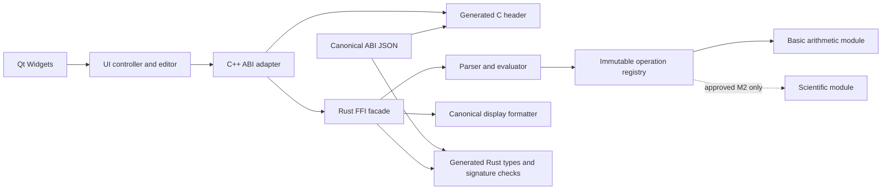

# ADR-0001: stateless Rust evaluator behind a generated C ABI

Status: proposed for independent review. Numerical behavior aligned with PM
spec commit `752d0961c8aacb2e79addeb6d1e26a7ea820d734`. Date: 2026-11-05.
Candidate 4 incorporates the selected lexical repeat policy; separate spec acceptance
and renewed exact-pair architecture review remain pending. No ABI declarations change.

## Context and decision

The project profile requires Rust/Cargo staticlib, a C++/Qt Widgets consumer built
with xmake, and source-level scientific extensions. The ABI must compile as C and
C++, contain failures, and allow independent component development.

Use a stateless full-expression call with caller-owned output storage. Rust owns
lexing, parsing, numeric evaluation, domain checks and display formatting. The UI
owns editing, focus, keyboard/button mapping and presentation of status codes.
There is no evaluator handle, cross-runtime allocation, callback, or free function.
Bounded expressions make synchronous M1 calls reasonable; measure responsiveness
in system QA. Pure calls may also execute on a worker, but Qt widgets stay on the
GUI thread and the controller discards stale results using its own request sequence.

The canonical declaration source is `contracts/calculator-abi-v1.json`.
`python3 tools/generate_abi.py` deterministically emits the C header, Rust constant
and function-pointer types, and producer type checks. `--check` fails on drift.
The producer must import the generated Rust module as `crate::abi_generated` and
include `producer_checks.rs` at crate root; its exports live in `crate::ffi`.
Rust functions use exported C symbol names and `extern "C"`; no `C-unwind`.
The generated checks check actual producer signatures; the later real C++ link
test checks symbol export and calling convention. Generation alone proves neither.

This small declaration schema avoids tool-version-dependent parsing and needs only
Python 3. It costs a small generator that must receive independent review. A
handwritten header plus handwritten Rust ABI was rejected because it can drift.
Generating a public header directly from calculator internals was rejected because
private refactors must not silently alter the public surface. A handle API adds
lifetime and stale-handle hazards without an M1 requirement for persistent state.

## Boundaries and dependency direction

Proposed paths: `core/` (Cargo crate, staticlib `calculator_core`),
`core/src/{ffi,parser,evaluator,format,registry}.rs`, `core/src/operations/basic.rs`,
`ui/` (Qt controller, adapter, widgets), `tests/integration/`, `tests/system/`.
The diagram denotes dependencies, not implementation already present.
No dependency from Rust to Qt, UI, xmake, or platform GUI libraries is allowed.
The C++ adapter converts byte spans and status/result records; it never reimplements
precedence, arithmetic, rounding, or domains. UI error wording is localizable;
numeric result bytes come from Rust. The adapter must serialize retained finite
doubles losslessly for exact-result continuation/repeat, as required by PM. This
is representation conversion; all arithmetic and compound-operand evaluation stay
in Rust. See c-abi-v1.md for transport and bit-identity checks. The UI selects the
repeat descriptor by current-text token roles/depth/spans under D-07: strip only
balanced whole-expression wrappers, then select the rightmost depth-zero binary
operator and complete RHS suffix, excluding unary/exponent signs. This lexical
selection has no precedence engine or arithmetic; Rust validates/evaluates the full
expression and RHS. The ABI does not expose a parser tree. See c-abi-v1.md for
transaction, descriptor lifecycle and unchanged stateless-call requirements.

## Source extension registry

The Rust registry is immutable after program startup and contains internal operation
descriptors: stable internal key, ASCII token/name, arity, fixity, binding power,
associativity, domain evaluator and required feature/module. These are Rust types,
not ABI structs or externally supplied function pointers. Parser and evaluator use
one registry. Duplicate token/fixity keys and inconsistent arities fail tests/build
validation; registry order must not change semantics. Basic `+ - * /` entries and
prefix signs are M1. Parentheses are parser structure, not runtime operations.

Approved M2 adds `operations/scientific.rs` and registry entries for its exact PM
list; angle mode flows as explicit per-call context, never global mutable state.
Adding a function requires grammar examples, domain and tolerance cases, error
mapping, regression tests and UI affordances, with no new ABI signature for normal
expression functions. No `dlopen`, external module search, runtime plugin discovery
or executable user extensions. Unknown identifiers return SYNTAX in M1. Adding
recognized tokens is a product/spec revision as well as an additive language change.
M2 implementation requires both recorded owner acceptance of the M1 first release
and a revision-pinned accepted scientific v1 contract compatible with the ABI,
covering operations, domains, angles, numerical accuracy/tolerance, errors and
display. Planning may proceed; neither gate is inferred satisfied.

## Build and platform proposal

- C public interface: C11. Consumer: C++17 or newer; use Qt Widgets 6.x.
- Core: Rust stable, edition 2024, `crate-type = ["staticlib", "rlib"]`,
  panic unwinding enabled in tested/release profiles, no fast-math assumptions.
- macOS: arm64, proposed minimum macOS 14; Rust target `aarch64-apple-darwin`,
  matching C++ target and `MACOSX_DEPLOYMENT_TARGET=14.0` across the whole link.
- Linux: x86_64, Ubuntu 24.04 minimum/test baseline, Rust target
  `x86_64-unknown-linux-gnu`; build on that baseline to avoid a newer glibc floor.
- xmake owns the executable/link; Cargo owns the staticlib. DevOps must pin exact
  Rust, xmake, Qt patch, SDK/compiler versions and artifact hashes in its readiness
  manifest. Do not mistake these proposed baselines for executed platform support.
  Link Rust's target-specific native system libraries using recorded Cargo/rustc
  output; never hard-code one platform's link flags onto both platforms.

Qt 6.8 documents arm64 macOS support and an SDK requirement separate from its runtime
floor. macOS 14 here is a project support choice, not a claim that Qt requires 14.
DevOps can propose a different pinned Qt 6 release with evidence and impact review.
[Qt 6.8 platform documentation](https://doc.qt.io/qt-6.8/supported-platforms.html).

## Failure containment and consequences

Every potentially panicking exported Rust operation is wrapped in `catch_unwind`
before output commit. Panic maps to INTERNAL with no partially formatted output;
the facade must also contain any panic when disposing of its panic payload (it may
deliberately leak that exceptional payload rather than unwind). No callback enters
C++; no C++ exception is permitted to cross into Rust. C++ catches its own adapter
allocation/conversion exceptions before returning to Qt event dispatch.
OOM abort, process termination, invalid memory access and stack exhaustion are not
recoverable panic promises. Enforce expression/depth limits before risky recursion.
[Rust FFI guidance](https://doc.rust-lang.org/stable/nomicon/ffi.html).

Caller buffers avoid allocator mismatch and teardown coordination. They require
documented lifetime, non-aliasing, and query/retry behavior. A process containing
undefined pointer misuse cannot be made safe by this ABI. Runtime tests are required
for valid pointers with rejected logical inputs; invalid arbitrary addresses must
not be used as a supposed recoverable-error conformance test.
